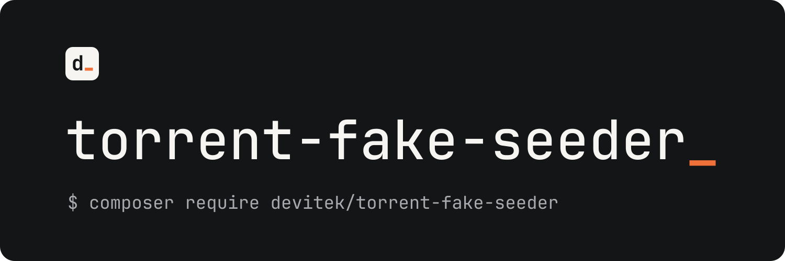

<p align="center">
  
</p>

<p align="center">A PHP proof of concept: report fake seeding statistics to a torrent tracker.</p>

<p align="center">
  <a href="https://packagist.org/packages/devitek/torrent-fake-seeder"></a>
  <a href="https://packagist.org/packages/devitek/torrent-fake-seeder/stats"></a>
</p>

<p align="center">
  <a href="#installation">Installation</a> ·
  <a href="#usage">Usage</a>
</p>

Trackers trust the upload figures that clients announce. This library shows how little it takes to exploit that: it reads a `.torrent` file, impersonates a known client (Azureus 4.5 or uTorrent 2.2.1) and announces upload progress to the tracker without sending any data.

> [!NOTE]
> This is a demonstration, not a tool to inflate your ratio. Use it only against trackers you run or are allowed to test.

## Installation

Requires PHP 8.4 or later.

```sh
composer require devitek/torrent-fake-seeder:dev-master
```

## Usage

```php
<?php

require_once 'vendor/autoload.php';

use Devitek\Net\Torrent\Client\Azureus\Azureus45;
use Devitek\Net\Torrent\Seeder;
use Devitek\Net\Torrent\Torrent;

$torrent = new Torrent('file.torrent');
$client  = new Azureus45();
$seeder  = new Seeder($client, $torrent);

$seeder->bind('update', function ($data) {
    echo $data['uploaded'] . ' MB at ' . $data['speed'] . ' MB/sec uploaded' . PHP_EOL;
});

$seeder->bind('error', function ($data) {
    echo $data['exception']->getMessage() . PHP_EOL;
});

$seeder->seed();
```

Swap `Azureus45` for `uTorrent221` (namespace `Devitek\Net\Torrent\Client\uTorrent`) to impersonate uTorrent instead.

## Contributing

Issues and pull requests are welcome.

## License

No license has been chosen yet, so all rights are reserved by default.

---

<p align="center">
  <a href="https://github.com/Devitek">
    <picture>
      <source media="(prefers-color-scheme: dark)" srcset=".github/assets/devitek-wordmark-blanc.svg">
      
    </picture>
  </a>
  <br>
  <sub>Built and maintained by <a href="https://github.com/Devitek">Devitek</a></sub>
</p>
